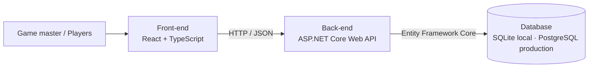

# Architecture

## Overview

Campaign Roster is a web application split into two independent parts that live in the same repository:

- **Front-end** — a single-page application in React + TypeScript.
- **Back-end** — a REST API in C# with ASP.NET Core, using Entity Framework Core to access the database.



## Repository layout

The project uses a monorepo ([ADR 0001](adr/0001-use-monorepo.md)). Each top-level folder is an independent project with its own build and deployment.

```
campaign-roster/
├── backend/            ASP.NET Core Web API (.NET solution, projects and tests)
├── frontend/           React + TypeScript application (Vite)
├── docs/               Architecture, data model and decision records
├── .github/workflows/  CI: build and tests on every pull request
├── CONTRIBUTING.md     Branches, commits and pull requests
└── README.md
```

## Environments

| Environment | Database | Purpose |
|---|---|---|
| Local (development) | SQLite file | Fast setup, nothing to install |
| Production | PostgreSQL | Persistent storage on the hosting provider |

Switching between them only changes the EF Core provider and the connection string ([ADR 0003](adr/0003-tech-stack.md)).

## Access control (MVP)

There is no login in the MVP. Each campaign has two codes ([ADR 0007](adr/0007-mvp-access-via-campaign-codes.md)):

- **MasterCode** — full access: edit the campaign, members and characters.
- **InviteCode** — read-only access for players.

## Planned for v2

- Authentication for masters and players
- Image upload
- Real-time updates with SignalR
- Full character sheet
