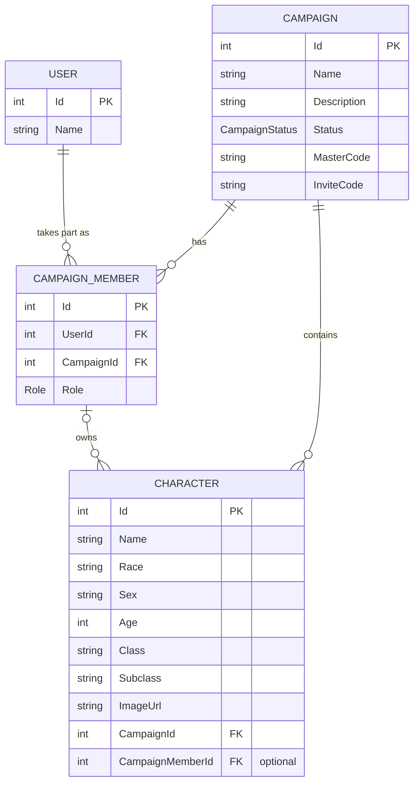

# Data model

## Entities and relationships

| Entity | Purpose |
|---|---|
| `User` | A person. Can take part in many campaigns. |
| `Campaign` | A campaign room created by a game master. |
| `CampaignMember` | Links a user to a campaign with a role. The same user can be the master in one campaign and a player in another ([ADR 0004](adr/0004-users-and-campaign-members-with-roles.md)). |
| `Character` | A character shown as a card. `CampaignMemberId` is empty until the character is assigned to someone. |

## Enums

| Enum | Values |
|---|---|
| `Role` | `Master`, `Player` |
| `CampaignStatus` | `Active`, `Paused`, `Finished` |

## Audit fields

Every entity inherits from `BaseEntity` ([ADR 0005](adr/0005-audit-fields-via-base-entity.md)), so every table also has these columns:

| Column | Type | Notes |
|---|---|---|
| `Id` | int | Primary key |
| `CreatedAt` | DateTime | Set automatically on insert |
| `CreatedBy` | int? → `User` | Who created the record. Optional until login exists |
| `UpdatedAt` | DateTime? | Set automatically on update |
| `UpdatedBy` | int? → `User` | Who last changed the record. Optional until login exists |

## Rules and constraints

- A user can join the same campaign only once: unique index on (`UserId`, `CampaignId`).
- A character belongs to one campaign and to at most one member of that campaign.
- `Race`, `Class` and `Subclass` are free text in the MVP ([ADR 0008](adr/0008-race-class-subclass-as-free-text.md)).
